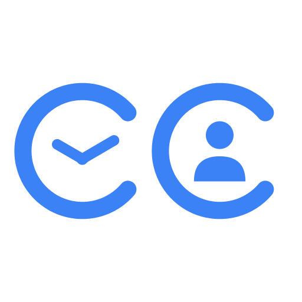
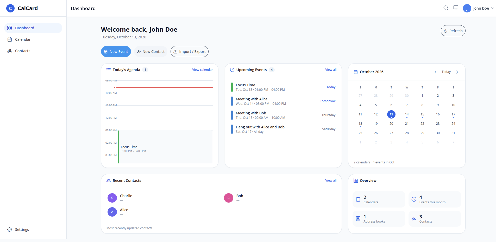
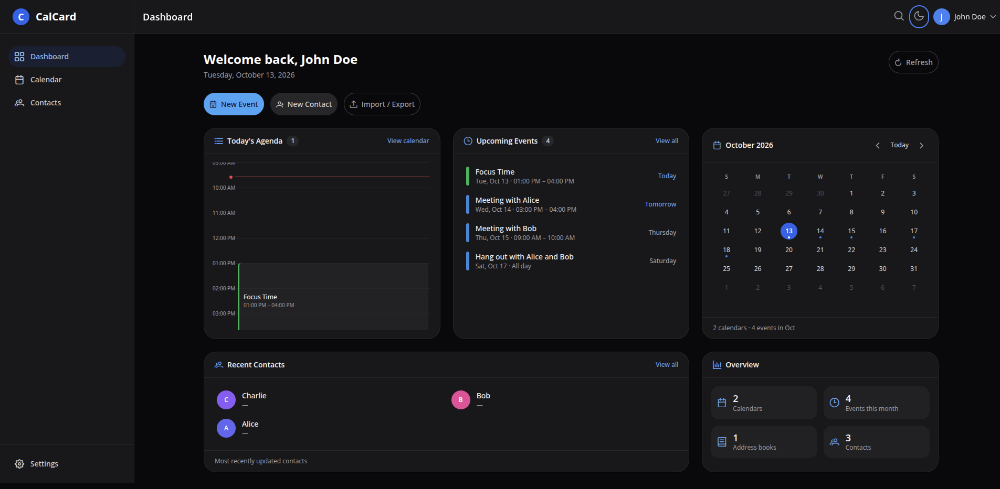
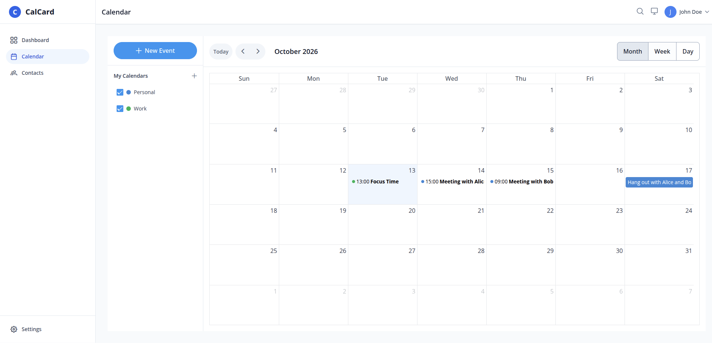
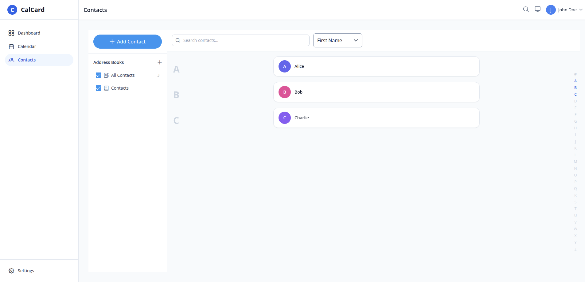
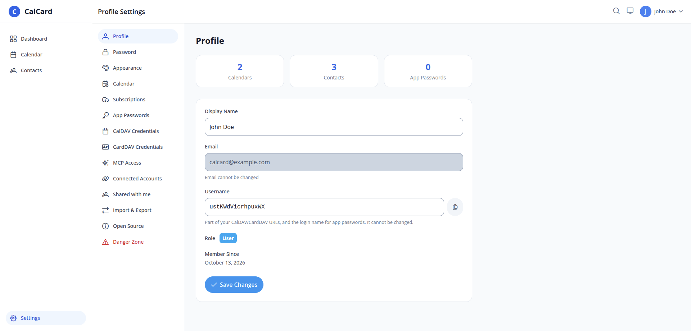

<p align="center">
  
</p>

<h1 align="center">CalCard</h1>

CalCard is a high-performance CalDAV and CardDAV server written in Go. It provides synchronization for calendars (RFC 4791) and contacts (RFC 6352) across various clients like iOS, Android (via DAVx5), Thunderbird, and more.

> ⚠️ **Status and disclaimer:** CalCard is provided as is, used at your own risk, with no warranty. It stores personal data, so keep regular backups, and back up before every upgrade, since some migrations can't be undone. Don't expose it to the internet without HTTPS.

## Features

- **Standard Protocols**: CalDAV (RFC 4791) and CardDAV (RFC 6352) synchronization, including WebDAV-Sync (RFC 6578).
- **Modern Authentication**: JWT-based auth and OAuth2/OIDC support (Google, Microsoft, 3rd Party).
- **Sharing**: Calendar and Address Book sharing between users.
- **Public Calendars**: Ability to publish calendars via unique URLs.
- **Security Focused**: Built-in TLS support, Rate Limiting, CORS, and Security Headers.
- **Flexible Storage**: Supports SQLite (default) and PostgreSQL.

> **Scope note:** CalCard is a personal **sync** server. It does not implement
> CalDAV scheduling (RFC 6638) — no attendee invitations (iTIP/iMIP), no
> `schedule-inbox`/`schedule-outbox`, and no free-busy. Events with `ATTENDEE`
> properties sync verbatim but generate no invitations. The server advertises
> only `calendar-access`, never `calendar-auto-schedule`.

## Screenshots

| Dashboard | Dashboard (dark) |
|---|---|
|  |  |

| Calendar | Contacts |
|---|---|
|  |  |



## Quick Start

### Prerequisites

- Go 1.25+ or Docker
- A secure JWT secret (at least 32 characters)

### Running with Docker (single container, web UI included)

The easiest way to get started is Docker Compose with the published image
[`herrj/calcard`](https://hub.docker.com/r/herrj/calcard). Two example compose
files live in [`docker-compose/`](docker-compose/) — copy one and adjust it:

| File | Database |
| :--- | :------- |
| [`docker-compose/docker-compose.yml`](docker-compose/docker-compose.yml) | SQLite (data in the `/data` volume) |
| [`docker-compose/docker-compose.postgres.yml`](docker-compose/docker-compose.postgres.yml) | PostgreSQL 18 (needs `POSTGRES_PASSWORD`) |

```bash
cd docker-compose
docker compose up -d                                   # SQLite
# docker compose -f docker-compose.postgres.yml up -d  # PostgreSQL
```

Both files pull `herrj/calcard:latest`; pin a version (e.g. `herrj/calcard:1.0.0`)
for anything you rely on. Each one also has a commented `build:` block for
building from source instead.

This is **one image** that serves everything on **one origin** (port 8080):
the REST API (`/api`), DAV (`/dav`), `/.well-known`, `/health`, **and the built
web UI**. Open `http://localhost:8080/` and the UI loads from the same
server that answers its API calls. `CALDAV_BASE_URL` is the address clients
actually use (e.g. `http://<nas-ip>:8751` or `https://cal.example.com`). Left
empty, the URLs the server hands out (the DAV server URL for an app password,
public calendar links) follow the address each request came in on; set it
anyway once you configure SMTP or OAuth, which require it. Behind a TLS-terminating
reverse proxy either set it or, if the proxy overwrites `X-Forwarded-Proto` /
`X-Forwarded-Host`, set `CALDAV_TRUST_FORWARDED_HEADERS=true`.

**First run:** open the UI — on an empty server it redirects to **Initial Setup**,
where you create the first account. That account is the administrator
(`is_admin`) and is signed in straight away. Setup works exactly once: after any
account has ever existed (deleted ones count), `POST /api/v1/auth/setup` answers `409`. Further users register
via `/auth/register` (unless `CALDAV_REGISTRATION_DISABLED=true`).

> **Exposed to the internet? Set `CALDAV_SETUP_TOKEN`.** Until the first account
> exists, anyone who can reach the server can create the administrator, or
> register as a plain user, which closes setup for good. With
> `CALDAV_SETUP_TOKEN=<long random string>` the setup page asks for that token
> and registration stays locked until setup is done. Left empty (the default),
> nothing is asked and registration is open: fine on a private network, but
> finish setup before exposing the server.

> **The container does not run as root.** It runs as uid/gid `1000`. A
> bind-mounted data directory (e.g. `/volume1/docker/calcard/data:/data` on a
> NAS) must be writable by that user, otherwise the server stops at startup with
> `Failed to initialize database: … unable to open database file: no such file
> or directory`. Either `chown -R 1000:1000` the host folder, or set the user
> and group ID in the compose file to the folder's owner (find them with
> `ls -ln`):
>
> ```yaml
> services:
>   caldav:
>     user: "1026:100"   # <uid>:<gid>
> ```
>
> Named Docker volumes (the default in the example files) need no setup.

Because the UI and API share an origin, the browser never applies CORS, so
**no CORS configuration is required**. The CORS settings
(`CALDAV_CORS_ENABLED`, …) exist only as an escape hatch for split hosting (UI
and API on separate origins); leave them disabled for the single-container setup.

> The SPA is baked at image-build time as a static bundle. Do **not** set
> `NUXT_PUBLIC_API_BASE_URL` for the single-container image — an empty value
> makes the UI issue same-origin relative requests. Set it only when hosting the
> UI on a different origin than the API.

### Building and publishing the Docker image

The release image is multi-arch (`linux/amd64` + `linux/arm64`) and published as
`herrj/calcard`. Run from anywhere — the script switches to the repo root itself:

```bash
docker login                                    # once, for the push
server/scripts/docker-release.sh                # version = git tag on HEAD, "v" stripped
server/scripts/docker-release.sh 1.0.0          # or give the version explicitly
server/scripts/docker-release.sh 1.0.0 --no-push   # build both platforms, don't push
```

Stable versions are also tagged `latest`; pre-releases (a version with a `-` suffix) never are.
The arm64 image is built under QEMU, so expect it to be slow. A single-platform
local build is just `docker build -f server/Dockerfile -t calcard .` from the
repo root.

Debugging DAV clients: set `CALDAV_LOG_PAYLOADS=true` to log every request's
headers and `/dav` bodies (credentials redacted) — see `CONFIGURATION.md`.

### Testing a deployment end to end

[`e2e/`](e2e/README.md) is a Python (pytest + httpx) suite that tests a running
server over HTTP only (REST, CalDAV/CardDAV, MCP): in `e2e/` install
`requirements.txt` into a venv, `cp .env.example .env`, set `CALCARD_URL`, then
`./run`. It registers throwaway users (self-registration must be enabled, SMTP
off) and removes what it created.

### Upgrading — back up first

**Back up the database before you upgrade.** On start the server migrates the
schema and then runs data migrations (`database.auto_migrate`, on by default;
`./server migrate` runs them by hand). Most only repair data, but two
**permanently delete** rows nobody can reach any more:

- the data of accounts deleted with older versions (their calendars, address
  books, shares and credentials), and
- the remains of calendars and address books deleted with older versions.
  Deleting a collection used to hide only the collection itself; its events,
  contacts, photos, sync history and shares stayed in the database. Deleting
  a calendar or address book now removes everything in it, and the first
  start of the new version purges what earlier deletes left behind.

Their owners asked for this data to be gone, but once the migration has run it
cannot be restored. With SQLite, stop the server and copy `caldav.db` (plus
any `caldav.db-wal` / `caldav.db-shm`) out of the data directory; with
PostgreSQL, `pg_dump` the database. The server logs what the purge removed as
a `WARN data migration: permanently deleted …` line with a row count per
table; a start with nothing to purge logs nothing.

### Running from Source

1. Clone the repository
2. Navigate to the server directory: `cd server`
3. Copy the example configuration: `cp configs/config.yaml.example config.yaml`
4. Update `config.yaml` with your settings (don't forget the JWT secret)
5. Run the server: `go run ./cmd/server`

For frontend development, run the SPA separately with `cd webinterface && pnpm dev`
(serves on `:3000` against the API on `:8080`); in that mode the UI defaults
`apiBaseUrl` to `http://localhost:8080`.

---

## Documentation

- **Configuration Reference**: [CONFIGURATION.md](CONFIGURATION.md) - Detailed guide for all YAML and Environment parameters.
- **Example Configuration**: [server/configs/config.yaml.example](server/configs/config.yaml.example) - A complete example YAML file.
- **Architecture**: [server/CLAUDE.md](server/CLAUDE.md) and the per-layer `CLAUDE.md` / `AGENT.md`
  files under `server/internal/` - layering, request flow, and conventions. (These replaced the
  former root-level `Technical Overview.md`.)
- **Feature status**: [STORIES.md](STORIES.md) - what is implemented, what remains.

## MCP Server (AI assistants)

The server exposes a [Model Context Protocol](https://modelcontextprotocol.io) endpoint at `/mcp`,
so an AI assistant can read and manage calendars and contacts on your behalf: list and search
events and contacts, create/update/delete them, find free slots across your calendars, and
create, rename or delete the calendars and address books themselves (your own only — a collection
shared with you stays the owner's to manage). Deleting a calendar or address book is permanent and
takes everything in it, so assistants are told to ask you first.

1. Sign in to the web UI and go to **Settings → MCP Access**.
2. Create a token. It is shown **once** — the server stores only a hash.
3. Point your client at the endpoint:

   ```bash
   claude mcp add --transport http calcard https://caldav.example.com/mcp \
     --header "Authorization: Bearer calcard_mcp_..."
   ```

A token grants exactly what the account can see itself, including collections shared with it, and
is revoked from the same page (revocation takes effect on the next request). Operators who do not
want an AI tool surface at all can remove the routes entirely with `CALDAV_MCP_ENABLED=false` — see
[CONFIGURATION.md](CONFIGURATION.md).

---

## Calendar subscriptions

Follow a calendar published elsewhere — a holiday calendar, a sports schedule, an export from
another service. The server fetches the feed on a schedule and mirrors it into a calendar of your
own, which then syncs to every CalDAV client like any other.

1. Sign in and go to **Settings → Subscriptions**.
2. Paste the feed URL (an `.ics` link; `webcal://` links work too) and pick how often to refresh
   — 15m, 30m, 1h (default), 6h, 12h or 24h.
3. The feed is fetched immediately, so a bad URL is reported there and then rather than surfacing
   as a silently empty calendar an hour later.

Subscribed calendars are **read-only**, to their owner as much as to anyone they are shared with:
the next refresh replaces their contents wholesale, so an event added locally would disappear
without a trace. You can still rename, recolour, share and delete the calendar itself. A feed that
stops responding is retried with exponential backoff and, after five consecutive failures, pauses
itself with the reason shown on the settings page; refreshing manually resumes it.

Because the server fetches URLs its users choose, feeds must be `https://` and on publicly
routable addresses by default. Self-hosted deployments whose users subscribe to feeds on the same
private network can relax both — see [CONFIGURATION.md](CONFIGURATION.md).

---

## API Documentation

There is no generated API reference. The REST surface is documented in
[server/CLAUDE.md](server/CLAUDE.md) (endpoint areas) and, per endpoint, by the
`// METHOD /api/v1/...` doc comment above each handler in
`server/internal/adapter/http/`.

---

## Web Interface

The project includes a modern web interface built with Nuxt 4.

### Prerequisites

- Node.js 26+
- pnpm (Recommended)

### Running the Frontend

1. Navigate to the web interface directory:
   ```bash
   cd webinterface
   ```
2. Install dependencies:
   ```bash
   pnpm install
   ```
3. Run in development mode:
   ```bash
   pnpm run dev
   ```
   The interface will be available at `http://localhost:3000`.

### Building and Deploying

To create a production-optimized build:

1. Build the project:
   ```bash
   pnpm run build
   ```
2. Preview the production build:
   ```bash
   pnpm run preview
   ```
